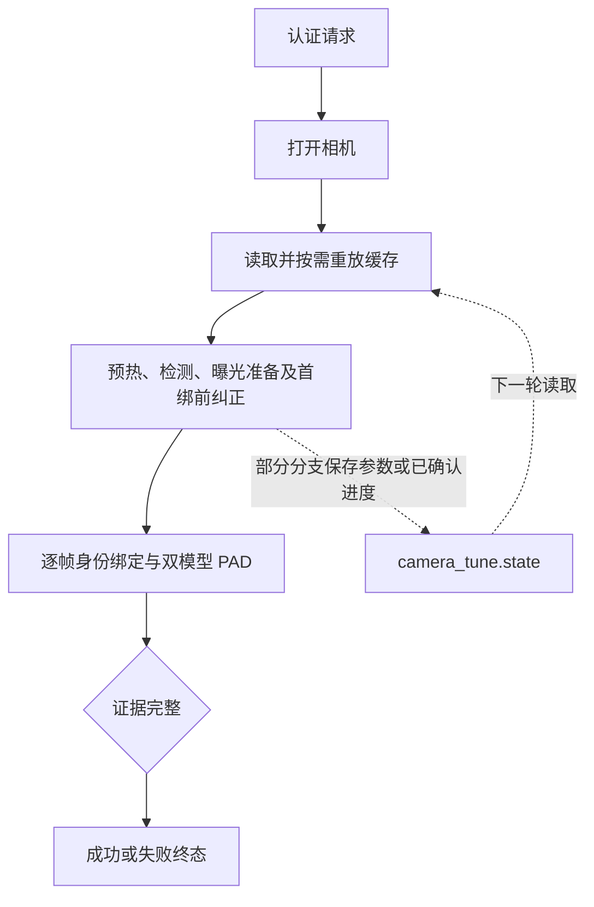

# 曝光问题与解锁提速方向

更新日期：2026-10-16。本文说明曝光问题、证据、改进顺序和验收条件。第 1 项已补齐确认中断后的稳定复核并加入自动回归，接续确认保存的精确路径已在真实锁屏验证，完整场景组仍待验收；第 4 项失败轮进度规则已实施并加入自动回归，待真机暗光验收；其余候选尚未实施。逐轮测试及安装包指纹见 [解锁性能记录](unlock-performance.md)。

## 当前结论

稳定画面的检测调度优化已在锁屏生效：安装前后各 9 次成功请求，完整认证交付中位数为 **551→521 ms**，曝光稳定门到验证循环为 **32.41→8.00 ms**。新版 8/9 次复用已完成人脸检测，9 次都选择第一预热帧。两批不是随机配对 A/B，约 30 ms 的完整差值不能全部归因于调度。

本次手机照片用于模拟亮环境识别后切换到暗环境。亮环境所需的低曝光在暗环境中需要重新调节，即使亮环境认证成功也一样；这种重新调节本身是正常行为。切换后的两次成功请求用了 **3561、3455 ms**，长于约 0.52 秒的稳定场景，应调查其中是否包含可避免的重放、往返调节和重复等待，不能把总恢复时间直接算作缺陷。

失败还涉及身份匹配：有一轮调节后亮度已到 57，但最近身份距离 0.929 超过当前阈值 0.800，未完成首个身份绑定。不能把所有失败归为曝光，也不能把照片未解锁单独记为 PAD 专项验收通过。

## 现行流程与缓存含义

worker 使用 [`AuthPipeline::Run`](../../../face_service/auth_pipeline.cpp)，曝光控制和缓存读写在 [`face_gain_tune.h`](../../../vision/face_gain_tune.h)。注册预览也使用这套调节器及同一 DataPath 下的 `camera_tune.state`；后续改变保存策略须联查 [`EnrollmentWizard.cpp`](../../../enrollment_app/EnrollmentWizard.cpp) 的预览启动与 `WatchPreviewExposure`。



**调节已确认、亮度合适、身份/PAD 成功是三个不同结论。** 当前保存参数不等待最终身份/PAD 成功。这是曝光缓存的现行语义，不能仅因认证失败就认定已确认的曝光参数无效。

| 环节 | 当前行为 | 边界 |
|---|---|---|
| 缓存内容 | 曝光、增益及可选自动/手动模式 | 没有成功认证标记、环境亮度摘要或设备标识；旧两行记录仍兼容 |
| 正常落带保存 | 亮度在 50–120，且无需缩短曝光时可保存当前参数 | 保存先于最终身份/PAD 判断；采集亮度合适不证明身份有效 |
| 调节进度保存 | 有实际调节、测量结论有效且未取消时保存 | 即使尚未落带也可保存，供下一轮继续暗光恢复 |
| 未确认调节 | 丢脸、取消、样本预算耗尽等未确认结果不覆盖旧记录 | 实际硬件可能已被写过，与磁盘缓存不同 |
| 未确认写入的接续确认 | 保存本次写入的响应背景和参数；新帧落带时独立复核稳定，再保存 | 不以身份/PAD 成败确认曝光；参数或模式变化、漂移、取消及旧帧不能授权保存 |
| 下轮重放 | 在预热和身份绑定前恢复缓存值及模式；相同且模式完整的值不重写 | 可修复驱动丢参数，也可能把刚恢复的硬件改回旧环境设置 |
| 失败轮进度保存 | 失败/取消/超时终态时，有旋钮写入且带人脸背书证据（稳定测量向带内移动超过容差，或无脸起点恢复出可信人脸 10–230）则保存最后一次写入目标 | 带内起点失败轮不保存；保存的是写入目标寄存器组合而非终态回读；错误猜测一轮内被触发测量自愈 |
| 无脸过亮入口 | 严格饱和判据（whiteout）或中央最暗四分位 ≥180（bright）均可进入有限下调 | 逆光暗脸（中央有暗主体）不触发；失败终态的人脸背书进度规则是唯一例外 |
| 无脸恢复 | 有限增亮或抑制过曝，无脸恢复本身不保存参数 | 出脸后另行确认；全局截止时间一直计时 |

实现入口为 `LoadTuneKnobState`、`ApplyTuneKnobState`、`TuneFaceExposure` 和 `SaveTuneKnobState`。具体值和生命周期以 [服务模块](../../modules/face-service.md) 为准。

### 环境切换与缓存的正常行为

**代码事实**：调节器可以先保存已确认的参数，随后身份匹配失败、PAD 不通过或认证超时。认证结果不等于曝光参数的适用性：失败认证中的参数可能适合当前亮环境，成功认证中的参数也可能不适合随后切换到的暗环境。

**日志证据**：用户确认 11:50:49 是手机照片测试。初始人脸亮度 213，曝光 -8→-9→-10→-11→-10，第一次调节约 2875 ms，最终约 5.013 秒超时。紧随其后的真人请求从 -10 开始恢复，约 3.561 秒后成功。

**解释边界**：这段序列说明发生了亮转暗后的恢复，不能证明“失败认证保存参数”是问题。不以身份/PAD 成败划分曝光缓存好坏，也不据此要求仅成功认证才保存参数。

## 曝光问题与待核实的额外耗时

### 1. 恢复后的旧缓存重放可能造成重复恢复（已修复，核心路径已锁屏验证）

**日志已确认**：11:50:56 的真人请求把硬件曝光恢复到 -8，中间一项调节因丢脸/抓帧失败未确认；11:51:04 明确记录 `exposure -8→-10` 的重放；11:51:09 又从 -10 恢复，最终达到 -7。这是实际重放，不只是对慢轮次的推测。

**机制与验证边界**：未确认恢复不覆盖旧缓存是当前保护；硬件已变亮、磁盘仍记录低曝光时，下轮可重放较暗设置。下述固定场景复现已确认这条链路；现场仍需要验证参数是否适合当前场景、恢复是否已确认，以及重放是否必要。仅认证成功也不能自动证明中途调节已稳定。

**归因限制**：11:51:04 的刺激物未明确标记；其脸亮度 59 在目标带内，失败的直接身份证据是距离 1.083 超过 0.800。能确认重放动作，但不能证明当时重放不适用，也不能仅据此认定这轮是真人误拒。需在环境不变的连续重试中隔离该额外耗时。

**自动定位（2026-10-13）**：已用实际 `AuthPipeline::Run`、`TuneFaceExposure`、缓存读写及重放构造两轮固定场景复现；仅替换传感器、画面和推理边界。模拟手动曝光 -9 时人脸亮度 22、-8 时恒定为 80，增益为 63；调到 -8 后仅在稳定测量的第一帧丢脸。两轮均完成三次身份绑定及所需 PAD，第一轮结束时硬件为 -8、磁盘仍为 -9；第二轮实际写入序列为 **-9、-8**。因此，无场景变化、无驱动重置也能触发旧缓存撤销恢复；这个代码机制已经复现，但不能由此确定上述现场轮次的全部归因。

修复前定位链路如下：

1. `detail::StepKnob` 先写硬件，随后 `detail::SettleFace` 因丢脸返回未确认；`measurementValid=false` 阻止本次落盘，旧缓存得到保留。这项保护本身应保留。
2. `TuneFaceExposure` 只返回写入步数，未向流水线传递待确认状态。后续画面落带时，首绑前纠正只处理出带帧，不再进入调节器的落带保存分支，也没有独立的稳定复核与保存；认证成功分支直接返回。缺口是**确认中断后没有接续确认恢复结果**，不是认证失败时不应保存。
3. 下轮在预热和场景测量之前调用 `ApplyTuneKnobState`。手动模式下，只要缓存与硬件数值不同就重放；当前逻辑不能区分驱动丢参数与上轮尚未确认的恢复，也没有当前场景适用性证据，因而又写回旧值。

对照只改变一个条件：不注入丢脸时，第一轮稳定确认并保存 -8，第二轮无写入；保留丢脸但在两轮之间使用现有 `detail::SettleFace` 独立确认方向性响应和稳定窗口，再保存时，第二轮也无写入。仅禁用第二轮缓存入口同样消除回退，但这只隔离因果，不是建议取消重放。诊断构建及四种运行方式见 [`build/diagnostics/stale-replay/README.md`](../../../build/diagnostics/stale-replay/README.md)。复现的 `FAIL` 表示“固定场景不重复恢复”这一候选目标未满足，不表示未确认参数应该直接保存。

**修复实现**：共享调节器通过宿主拥有的 `FaceTuneRecovery` 保留最后一次写入的亮度背景、方向及参数快照。调节稳定或进度成功保存时清除待确认状态；丢脸、样本预算耗尽或无脸恢复尚未取得人脸稳定依据时保留。worker 使用的流水线在首个计帧前遇到落带新帧时，最多接续复核一次；使用原稳定门、严格递增帧序号和原 5 秒截止时间，复核期间暂停 PAD 阶段计时并丢弃触发帧。参数/模式须在测量前后与快照相同，有曝光控制时须可确认手动模式；满足稳定且仍落带时才保存，身份/PAD 判断仍独立执行。复核失败后不凭单帧落带补存；真实未确认结果仍可能在下轮重放，这是保留的保护。

注册预览启动调节和后台 watch 使用同一接续确认状态。后台每 3 秒检查一次落带人脸，不受写参数的 10 秒冷却限制；复核不写硬件，采集期间跳过，取消、停止、重新建图及参数变化不允许沿用旧确认。缓存格式、路径、普通重放及已确认的出带进度保存保持兼容，没有增加场景/设备标识。

回归入口为 `AuthPipelineTest --tune-recovery`。修复前稳定场景报出三项失败：两轮均未更新旧缓存、第二轮重复写入；修复后稳定场景及身份拒绝、PAD 失败、取消、断开、持续漂移和冻结帧场景通过。`FaceGainTuneTest` 另覆盖恢复测量前后参数变化、丢模式、无响应、再次丢脸、出带及落带分支不得绕过失败复核。原生产流水线诊断默认场景由 FAIL 变为 PASS，原始结果与修复后结果分别保留在诊断目录。必要构建与测试结果见下述验证要求。

下一轮是否重放仍需兼顾驱动丢值/丢模式、场景及设备变化；本次没有取消重放，也没有在认证成功时直接补存。模拟耗时不用于估算真机收益。本次未运行新的相机探针、standalone、注册 GUI 或锁屏对照：自动输入用于固定场景隔离机制，真实光照切换、录入身份及锁屏需要现场操作，仍按后文条件验收。

### 2. 曝光往返调节与首绑前纠正叠加耗时

**现象已确认**：11:50:49 中 -10 时亮度约 120，降到 -11 后约 38，再回到 -10 后约 119；首绑前又尝试 -11，亮度约 37。每次写入等待响应数百毫秒，部分超过 900 ms，往返消耗了大部分 5 秒预算。

**原因仍待隔离**：驱动曝光粒度、传感器延迟、手机屏幕时变亮度、脸框变化及重新进入调节都可能参与。当前日志未隔离这些变量，不能直接认定驱动故障或某条判断错误。

亮度日志用 `%.0f` 舍入，显示“120”仍可能实际大于 120，显示“50”也可能小于 50。后续应补足用于判断的亮度精度、写入前后参数、帧序号、响应确认方式及纠正原因，不能凭整数日志认定边界判断有错。

### 3. 稳定等待昂贵，但不能直接删掉

[`FaceSettleGate`](../../../vision/face_gain_tune.h) 已支持提前结束：观测到方向性响应，至少 4 个样本形成持续至少 200 ms 的稳定窗口，并通过漂移检查时，可在 900 ms 前确认。缺少响应证据时，900 ms 是回退等待下限，仍要求稳定；它不是每次写参数都必须睡满的固定延迟。

11:49:31 的一次增益恢复读了 40 个样本、耗时 1326 ms，仍未确认稳定；其他轮次有丢脸或取消。缩短等待、把样本耗尽当作稳定，可能使旧帧进入认证或保存未确认设置。应优先减少无用重放和调节，再根据真实响应评估等待参数。

### 4. 失败轮的恢复进度随进程边界丢失，重放造成跨轮振荡（已实施失败轮进度规则，待真机验收）

**日志已确认（2026-10-16 09:24–09:25）**：亮光稳态 `exposure=-8/gain=63` 持久化在缓存。真暗光轮次中，无脸恢复每轮把曝光拉亮两档到 -6，但恢复确认依据是场景亮度而非人脸响应，只挂进程内存的待确认状态；worker 每轮一个新进程，待确认状态随进程退出丢失，下一轮重放又把 -6 压回 -8。三轮困在 `-8 →(恢复)→ -6 →(重放)→ -8` 振荡，连人脸检出都没有。第四轮靠迟到纠正拉到 -4（写入未确认，同样未落盘），驱动在通电周期内记得该值才继续。同日 09:26–09:28 的失败主因是极暗下满增益+无帽曝光 -3 的 8 fps 悬崖与运动模糊把身份距离推到 0.80–0.855 压线，属于光子不足，不是本条规则的范畴。

**修复（2026-10-16 实施，未提交）**：`AuthPipeline::Run` 的全部非成功终态（失败、取消、超时、预环中止）统一结算失败轮进度。条件是有旋钮写入且带人脸背书的进展证据：出带起点的稳定测量向带内移动超过 `settleTol`，或无脸起点在轮内恢复出可信人脸（亮度 10–230）。满足时把 `TuneWriteTracker` 记录的最后一次写入目标（写入成功后的寄存器组合，非失败时刻的驱动回读——回读可能停在未生效中间态且与 graph 拆除竞争）写入 `camera_tune.state`。写入目标即使未经生效确认也可保存：寄存器值即目标值，下一轮重放后由触发测量重新验证效果；错误猜测一轮内自愈，不产生只升不降的棘轮（成功轮的带内保存与过亮下调照常工作）。带内起点的失败轮不保存：问题在姿态或距离，不动盘上已认证组合。纯场景证据（无脸到轮终）仍不保存，保持"场景亮度不是人脸响应"的边界。判定逻辑集中在 `EvaluateFailedRoundTuneProgress`（`vision/face_gain_tune.h`），核心调节、无脸恢复与迟到纠正路径在写入成功后登记写入目标、稳定测量登记亮度；日志行族 `Failed-round tune progress saved/not saved`。Console 预览不接写入跟踪，行为不变。

**验收条件**：真机暗光下，第一轮的无脸恢复或未确认纠正在本轮失败后，缓存应体现拉亮后的写入目标（日志出现 `Failed-round tune progress saved (face appeared)` 或 `(settled toward band)`），下一轮重放从该值起步而不是旧稳态；亮光正常成功轮无新日志行；带内起点失败轮出现 `not saved` 行且缓存不变。

### 5. 过曝但未达饱和判据的无脸场景没有任何恢复入口（已实施 bright 证据，待真机验收）

**日志已确认（2026-10-16 12:39–12:40）**：10:15 的调谐把缓存缩到 `exposure=-4/gain=63`（暗光组合）；中午环境变亮后该组合过曝，detector 检不到脸。三轮完全相同：预热稳定、trigger 无脸、`IsSceneWhiteout` 不满足（严格判据要求 25 宫格中 ≥20 格 70% 像素 ≥245 且中央 9 格全饱和——过曝帧里残留的头发/衣物结构把判据拉不到门槛）、`IsSceneDark` 显然不满足，于是无任何旋钮写入（tune 0.07 ms、无传感器调用），每轮 2.5 秒空场景失败。失败轮进度规则在此帮不上：没有写入就没有可保存的进度。

**修复（2026-10-16 当日第二包）**：新增 `IsSceneBright`——`CentralSceneLuma >= kBrightSceneLuma(180)`，与暗光判据（`maxNoFaceLuma=30`）对称（上限 120 的 1.5 倍对下限的 0.6 倍）。中央三分之一最暗四分位都已 ≥180 说明画面中没有可被压暗的暗主体，逆光暗脸保护不受影响。三处入口接入：认证预环的恢复分支、自足版调节的 measure 回调（`clipped = !face && (whiteout || bright)`，让 `RecoverSceneWhiteout` 的内部循环接受宽证据）、注册预览的观察入口。恢复动作复用现有 `RecoverSceneWhiteout` 有限下调。同日修正 trigger 日志笔误：三元内层 `no face` 被误写为 `no fresh frame`（2026-10-16 首包），导致该时段日志的 no-face 轮被误读为 seed 失效。

**验收条件**：白天对着过曝（未达白爆）的相机解锁，应出现 `No-face whiteout recovery: exposure …→…` 行并在有限步内恢复人脸检出；逆光亮窗但人不在画面时不得反复下调（中央有暗主体时 `IsSceneBright` 为假）。

## 可以提速的地方与优先顺序

| 顺序 | 方向及状态 | 证据与收益边界 | 实施前需要解决什么 |
|---|---|---|---|
| 已完成 | 稳定手动曝光复用第一帧检测 | 生产稳定门后 32.41→8.00 ms；完整交付 551→521 ms，非受控 A/B | 保留漂移、过期、写参数及模式未知时的回退；不能重复计算这项收益 |
| 已修复，待真机验收 | 同一环境连续重试时，接续确认恢复结果后避免旧缓存撤销恢复 | 固定场景 -8→-9→-8 的生产流水线回归由 FAIL 变为 PASS；现场收益及原 -8→-10 的适用性仍未确定 | 检查普通轮次无退化，真实未确认结果仍不保存，驱动丢值/丢模式与环境变化仍可恢复 |
| 已实施，待真机验收 | 失败轮进度规则：失败终态保存带人脸背书的写入目标，跨轮接力暗光爬升 | 2026-10-16 09:24–09:25 三轮 `-8↔-6` 振荡归零；无脸→有脸与出带→settled 改善两类凭证 | 带内失败轮不保存；纯场景证据仍不落盘；预览行为不变 |
| 优先候选 | 调节与首绑前纠正共用本轮响应历史，减少往返 | 已见 -10/-11 往返和重复纠正；目标是减少无依据写入及其等待 | 隔离驱动步长、画面变化和响应滞后；真实环境变化时仍须允许重新调节 |
| 调查 | 缩短相机启动到首回调的采集链路 | 当前锁屏 Run 前到首回调中位数 279.01 ms，是常规请求的大项 | 分离 Run 调用与流等待，定位设备/驱动/建图成本；不能承诺 279 ms 全可回收 |
| 低优先级 | 事件取帧、诊断读取与拷贝 | 锁屏缓冲就绪到取帧中位数 5.97 ms；桌面拷贝约 0.4–1.0 ms，历史事件取帧候选约 5–6 ms | 用户此前已放弃事件取帧；重启该方向须有新证据，传感器读取与等帧重叠部分不能重复计收益 |

曝光恢复的 3561/3455 ms 是总时长，不是已测出的可回收量，不能承诺所有恢复轮次降到 0.52 秒。首帧链路也只有计时定位，尚无新的生产提速实现。

模型优化暂不优先：既有本机实验中 SFace 完整调用约 5 ms，推理与采集部分并行；三帧快速模式两段采集间隔至少共 120 ms。没有证据支持更换模型、降低身份/PAD 门限、减少计帧或缩短 60 ms 守卫来解决这些曝光问题。

## 缓存与调节改进的条件

优化依据应是**当前场景适用性、传感器响应与稳定证据**，不预设“成功认证参数优先于失败认证参数”，也不预设需要按认证结果拆分缓存。

1. 保留已确认调节结果与进度的保存能力，包括认证失败的轮次。身份不匹配不否定曝光已稳定；若完全禁止失败轮保存进度，真实暗处可能每轮回到旧值，无法累积到曝光回退阶段。
2. 未确认结果不直接升级为稳定参数。认证最终成功也不能代替传感器稳定检查；若考虑在退出时补存当前参数，须取得当前组合适合场景且已稳定的证据，不能只检查 `AuthPipelineResult::succeeded`。
3. 重放须考虑设备、场景适用性、驱动是否丢值/丢模式，以及当前参数是否形成有效恢复。数值相同但模式丢失时仍要恢复模式；亮转暗、暗转亮本身需要调节，不能以消除这些必要调节为目标。
4. 硬件值和磁盘记录可能不同。先明确现有稳定依据及生效顺序，再判断是否需要写硬件；新写入仍要验证响应、丢弃旧 seed、遵守原截止时间。没有证据时不宣称旧记录一定不适用。
5. worker 和 Enrollment 持久化入口一起核对。保存条件以曝光适用性和稳定依据为准，联查注册预览及采集，避免只考虑锁屏终态。
6. 若实际方案改变 `camera_tune.state` 格式或增加记录，须兼容旧两/三行记录并同步路径、资源及模块文档。本次没有改变现行格式。

调节器的候选改进是共用本轮已尝试参数及实测响应，避免画面未出现新变化时再选择刚被证实会过暗的组合。真实光照改变后必须允许重新评估，不能永久禁止试过的值。边界滞回或目标余量须依据未舍入亮度和驱动步长验证，不直接放宽 50–120 带掩盖问题。

## 验证要求

先用生产 `AuthPipeline::Run` 与共享调节器做自动回归，再做真实相机与锁屏对照。自动输入替换传感器反馈、图像和推理边界，保留实际调度。每个候选一次只改一个变量。

| 必测场景 | 要证明的结果 |
|---|---|
| 稳定场景连续成功 | 保留三次身份绑定、所需 PAD、递增序号和至少 60 ms 间隔，没有新增写入或常规慢尾 |
| 亮环境认证成功或失败后切换暗环境，以及暗转亮 | 两种认证结果都允许正常曝光恢复；比较必要调节之外的重复写入与等待，失败不能放行 |
| 环境不变，硬件已调亮但本次未确认，随后重试 | 不把未确认结果当作稳定参数；核实是否存在可避免的恢复撤销，选择依据可观察 |
| 真实暗处跨两轮以上恢复 | 已确认进度可继续推进，不能每轮归零 |
| 驱动丢模式但保留数值，或设备变化 | 模式恢复正确，不同设备缓存适用性受检验；指定设备缺失仍失败，不切换设备 |
| 延迟、无响应、持续漂移、曝光往返及亮度边界 | 不提前确认、不保存漂移值，不用舍入日志作决策；共享历史减少无依据重复写入 |
| 首绑前丢脸、迟到入场、停帧、取消与断开 | 旧帧不复用，共用 5 秒预算；终态后相机释放，不把部分证据判为成功 |
| 注册预览与采集 | 保存条件明确，帧缓存锁及 COM 公寓规则保持；GUI 实测与锁屏结果分别记录 |

硬件对照固定设备、站位、录入及身份/PAD 门限，交替运行旧/新版本。稳定场景、真实暗光、强光恢复、手机照片干扰、迟到入场和取消分组记录；每轮写明刺激物、请求时间和结果，首次启动慢轮次保留且单独标记。常规组建议每版至少 20 轮，检查中位数、P90、最大值及所有失败；光照切换组至少重复 5 个完整周期。这是本机工程比较的样本建议，不代表总体识别率或攻击成功率。

同时评价正常速度有无退化、环境变化的成功率和慢尾、写入/重放/纠正次数。先测出改善幅度再承诺时间目标。照片在身份门先被拒绝的轮次，不能用于量化 PAD 防照片能力。

必要验证为 Service/Console Release、AuthPipelineTest、FaceGainTuneTest、ExposureWarmupTest、LivenessTimingTest、AuthWorkerProtocolTest、ModelIntegrityTest；worker 生命周期变更另做进程/Job 故障注入，相机生命周期变更另做指定设备 CameraLifecycleTest child 100 轮与 Session 0，持久化变化联查注册 GUI。命令以 [`BUILD.md`](../../BUILD.md) 为准。

2026-10-13 第 1 项修复的自动验证：Service/Console Release 构建及以上七项测试全部通过；`AuthWorkerLifecycleTest` 使用 mock worker 执行 100 轮，不能替代真实相机生命周期。`FaceGainTuneTest` 还重放既有 `exposure-response-20260919-validation.csv`，稳定门规则保持。原复现及三个对照均 PASS，修复后逐项输出与源码哈希见 [`results-after.json`](../../../build/diagnostics/stale-replay/results-after.json)，完整流水线输出见 [`auth-pipeline-test.log`](../../../build/diagnostics/stale-replay/auth-pipeline-test.log)。未部署新版到系统，真实光照切换、standalone、注册 GUI 和锁屏验收尚未执行。

## 本次安装包与真实场景复测

2026-10-13 已通过 `scripts/build_installer.ps1` 构建完整 Windows x64 安装包（当时未自动安装）：历史标记副本 `FaceLoginSetup-exposure-recovery-20261013.exe`，版本 1.8.0，68036608 字节（约 64.9 MiB），SHA-256 `0c6e2e65fd9fcc7d926cb3727a8162a5366bfa57e791dd6af0b477519d72e620`。同一包当时也输出为默认 `FaceLoginSetup.exe`；该标记副本现已不在当前构建目录。当前 [默认安装包](../../../installer/FaceLoginSetup/build/bin/FaceLoginSetup.exe) 已被后续同源重建覆盖，实际复测指纹见下节，不能继续用历史包哈希核对当前部署。

完整 EXE 内嵌的 zip 与本次 `payload.zip` 字节一致；16 个文件符合资源白名单，两个包含修复的 EXE 与当前构建产物一致，四模型与已有正式模型一致。完整/slim Wails 构建及前端编译成功，额外 `go test ./...` 通过。载荷和源码指纹见 [`exposure-recovery-package-20261013.json`](../../../build/exposure-recovery-package-20261013.json)，构建输出见 [`installer-exposure-recovery-20261013.log`](../../../build/installer-exposure-recovery-20261013.log)。

### 准备与记录

运行上述安装包，在当前安装目录选择“更新”。完成后关闭注册预览，整组测试保持同一摄像头、站位、录入及身份/PAD 阈值；保留 `camera_tune.state`，它是本问题的跨轮状态。安装器会停止旧服务并启动新服务，原模型与数据格式不变。安装后的参数以实际 `data/config.json` 为准。

版本号与之前同为 1.8.0，须核对已安装服务文件哈希。下方只读命令针对上述历史包；安装后续重建包时应使用该包的服务指纹，而不是历史记录。22:19 的实际部署指纹见下节。

```powershell
$flReg = Get-ItemProperty -LiteralPath 'HKLM:\SOFTWARE\FaceLogin'
$flDataDir = $flReg.DataPath
$flManifest = Get-Content -LiteralPath 'D:\face_login\FaceLogin\build\exposure-recovery-package-20261013.json' -Raw | ConvertFrom-Json
(Get-FileHash -LiteralPath (Join-Path $flReg.InstallPath 'FaceLoginService.exe') -Algorithm SHA256).Hash -eq $flManifest.file_sha256.'FaceLoginService.exe'
```

每轮记下触发时间、刺激物（真人/照片）、开关灯和短暂离场动作、Windows 是否解锁；失败轮次也保留。测试后使用时间范围对齐 `service.log`、`auth_worker.log` 和 `credential_provider.log`。查看曝光相关关键行可用：

```powershell
Select-String -LiteralPath (Join-Path $flDataDir 'log\auth_worker.log') -Pattern 'Tune state replay|Exposure tune trigger|No-face dark recovery|Late exposure correction|Sensor settle|Tune step|Interrupted camera tune|Liveness passed|Authentication evidence incomplete|Auth worker timing'
Get-Content -LiteralPath (Join-Path $flDataDir 'camera_tune.state')
```

日志方括号中的数字是线程 ID，不能当作进程 ID。结合时间段、worker 启动记录中的 `pid=` 和请求/终态边界分轮。缓存应在该轮结束后、下一轮开始前读取；只取测试结束时的一份不能证明每轮保存顺序。

### 操作与判定

1. **普通组**：在正常室内光下连续锁屏解锁 20 次，记录所有成功、失败及完整耗时；首次启动慢轮单独标记。检查没有新增接续复核、重复数值重放或常规慢尾。与同设备旧版的普通组比较中位数、P90 和最大值；旧日志只能作参考，受控 A/B 才能量化收益。
2. **亮转暗恢复组**：先在较亮环境用真人认证一次，让参数适应亮环境；随后降低环境照度，在固定站位发起真人认证。恢复期间短暂转头或离开画面约 0.2–0.5 秒，然后立即回到原站位，尽量让丢脸发生在曝光写入后的稳定测量阶段。可另行复刻之前的手机照片刺激，但须明确记录照片轮；照片未解锁不能算 PAD 专项结论。
3. **命中修复路径**：在同一请求中看到 `Tune step ... unconfirmed` 或相应无脸恢复写入，随后出现 `Interrupted camera tune reconfirmed: face luma ... — state saved`。核对该轮缓存与最后写入后复核的组合一致，再检查 Windows 实际结果。身份或 PAD 拒绝仍应失败，即使曝光已确认并保存。
4. **紧接着重试**：保持当前光照、站位及设备，立即再次锁屏/重试。该轮应使用恢复后的组合，不出现撤销它的较暗旧值数值重放并再次调亮。驱动确实丢模式或丢参数时仍允许恢复；出现 `Tune state replay` 本身不是失败，须看写入原因与前后数值。恢复轮次可以耗时较长，不要求一律达到稳定场景约 0.52 秒。
5. **反向与保护组**：重复至少 5 个完整亮暗周期，并测试暗转亮；另做持续离场和恢复期间取消。没有独立稳定依据时不应出现 `reconfirmed ... state saved`；检查失败复核没有覆盖最近一次已确认的缓存。已确认的进度可以先保存，不能要求所有失败认证的缓存完全不变。注册 GUI 另测一次预览恢复及采集：接续复核可保存，采集期间不得后台调节，关闭预览后相机释放。

若始终没有出现未确认调节，则本轮只验证了普通恢复，**尚未覆盖第 1 项的修复分支**。若已出现 `reconfirmed ... state saved`，下一轮在相同场景仍回放旧暗值，保留这两个请求、期间缓存内容及操作时间作为失败样本。需要精确对比旧/新版本时，每版分别执行相同周期，保留各自包哈希、初始缓存、配置与全部请求，不把相机自动继承的参数当作相同起点。

### 安装后实际复测（2026-10-13 22:19–22:21）

已安装服务 SHA-256 为 `9e99611f9e7ec3214ece7f6688b0ae6babd1178792dec9d85f012d66db8280cf`，与读取时的 Release 服务及打包资源字节一致；与上述 22:10 历史包的服务指纹不同。核对 `face_gain_tune.h`、`auth_pipeline.cpp`、`EnrollmentWizard.cpp` 三份源码，哈希均与历史包来源记录一致，属于同一修复源码的后续重建。当前默认安装包 SHA-256 为 `2201b4c6f52d6fd539542326f1ca5f65ef6f5c2319822cecb3a9c5e3acaed4c5`。不能仅因与历史服务哈希不同就判定未安装修复。

以 22:19:41.702 服务重启为界，至 22:21:07 共 **15 次请求：12 次 Windows 确认成功，3 次约 5 秒超时**。用户明确确认 22:20:24.472、22:20:30.837、22:20:50.018 三轮均展示手机照片；其余轮次未逐一标注刺激物。11 次没有曝光调节的成功请求中位数 **518 ms**，范围 504–1166 ms；1.166 秒轮次有 13 次身份绑定尝试且帧序号不重复，没有曝光写入，不能将该慢轮归为缓存恢复。此批不是受控 A/B，不能据 518 ms 与旧批 521 ms 比较宣称提速。

关键链路：

- **22:20:24 照片**：曝光 -7→-8→-9→-10 的三次稳定测量均耗尽 40 样本预算，未确认；该请求约 5001 ms 超时。下一轮 -10→-7 是回到保留的旧亮值，不是撤销已确认的暗光恢复。
- **22:20:30 照片**：最终 -9→-10 的测量未确认，随后 **22:20:35.018** 实际出现 `Interrupted camera tune reconfirmed: face luma 108.87 — state saved`。这证明新接续复核已在真实锁屏执行，且不依赖认证成功保存曝光；该照片请求仍在约 5010 ms 超时，没有 Windows 成功。
- **22:20:37 后续成功**：从 -10 开始，无脸恢复到 -9；22:20:40.885 的 -9→-8 因丢脸/抓帧失败未确认。下一帧亮度仍为 44，触发第二次纠正 -8→-7；430 ms 后确认亮度约 89 并保存，完整交付 **4131 ms**。这轮最后通过新一次完整调节取得稳定依据，不是“丢脸后仅接续复核、没有再写参数”的精确回归场景。
- **22:20:44、22:20:47**：两轮均从 -7、增益 63 开始，没有数值重放或再次调节，分别 **514、515 ms** 经 Windows 确认成功。没有出现原序列中恢复后又写回旧暗值的现象。
- **22:20:50 照片**：最后写到 -10 的测量与接续复核均耗尽稳定样本预算，约 5011 ms 超时，未出现接续保存日志。下一轮 **-10→-7** 重放亮值后约 538 ms 成功，随后两轮约 527、504 ms 成功；最终缓存为曝光 -7、增益 63、手动模式。这符合“未确认仍保留旧记录”的保护。

本轮可确认接续复核真机生效、已确认恢复未在后续重试中被旧暗值撤销、普通成功轮次保持约半秒；尚未完整覆盖真人丢脸后不再调参而接续确认的精确路径，也未完成 20 轮普通组与 5 个亮暗周期。照片没有解锁，不能单独归因为 PAD 通过防照片验收。匿名逐轮证据、日志快照哈希和实际部署指纹见 [`exposure-recovery-installed-test-20261013.json`](../../../build/exposure-recovery-installed-test-20261013.json)；一次性分析脚本已清理。本次只读取日志和部署文件并记录结果，没有修改安装文件、缓存、配置或硬件参数。

### 追加复测（2026-10-13 22:29–22:30）

服务文件哈希保持不变。本批 **9 次请求：5 次 Windows 成功、3 次身份未匹配、1 次超时**。用户确认 22:29:50、22:30:24、22:30:36 三轮展示手机照片，22:30:01 的超时是在反复故意遮挡；其余请求未逐一标注刺激物。照片轮均为 identity=0/3、PAD=0/0，没有进入 PAD 计帧；不能用这三轮量化 PAD 防照片能力。

**本次补齐精确接续确认路径**：22:30:29.099 发起的请求从 -10 开始恢复，22:30:31.976 的 -9→-8、22:30:32.111 的 -8→-7 均因丢脸/抓帧失败未确认。之后没有再写参数；独立复核用 261 ms 取得方向性响应及稳定窗口，**22:30:32.519** 记录 `Interrupted camera tune reconfirmed: face luma 91.22 — state saved`，22:30:32.702 经 Windows 确认成功，完整交付 **3603 ms**。这次完成了上批缺少的“最后一次调节未确认，随后仅靠独立复核保存”的真实锁屏验证。

下一轮 22:30:36.801 的刺激物为手机照片，触发日志仍从 **-7、增益 63** 开始，没有先把 -7 数值重放到旧 -10；随后画面亮度 219，调节器才按当前亮环境下调到 -10，并稳定保存。它证明接续保存后旧值没有在下轮准备阶段重新覆盖硬件，但该轮改变了刺激物，不是同一暗环境的连续成功对照。

**保留的失败保护也被触发**：22:30:08.043 的请求先把 -9→-8→-7 写亮，两个调节稳定测量均丢脸/抓帧失败；接续复核也在 554 ms 时因丢脸/抓帧失败中断，因此没有保存。该轮后来虽然在 4553 ms 成功，认证结果未替代曝光稳定依据；22:30:24.753 仍出现 -7→-10 的旧缓存重放。这是当前有意保留的边界：接续复核再次失败时仍可能回放旧值，修复没有保证所有遮挡情形都消除跨轮重放。22:30:24 的刺激物已切换回照片，不能把该轮重放直接归为同环境真人的无用恢复。

最后一个恢复请求耗时 4237 ms，在完整调节中确认并保存 -7；紧接的稳定请求耗时 **540 ms**。本批最早一个稳定请求为 **516 ms**。最终缓存为曝光 -7、增益 63、手动模式。必要恢复仍约 3.6–4.6 秒，不能宣称这次修复将全部恢复轮次降到半秒。

结论：接续确认成功后保存、以及复核失败不凭认证成功补存，这两个核心分支均已在真实锁屏观察到。20 轮普通组、5 个完整光照周期及注册 GUI 仍未全部完成。匿名逐轮数据与日志快照指纹见 [`exposure-recovery-installed-followup-20261013.json`](../../../build/exposure-recovery-installed-followup-20261013.json)；一次性分析脚本已清理，本次未修改生产行为。

## 证据与计时口径

主要证据为 [`unlock-installed-test-20261013.json`](../../../build/unlock-installed-test-20261013.json) 的匿名逐轮数据及日志快照哈希、[安装后记录](unlock-performance.md#installed-unlock-test) 和实际源码。11:49:24–11:50:09 的逐轮刺激物没有完整标记；11:50:49 的照片失败与紧随其后的真人成功由用户明确确认。

完整交付从 CP 发请求计到 Windows `ReportResult`，不含按键前等待或桌面动画。模型已预载时不重复加全部加载时间；请求早于 ready 时只计剩余等待。

`run_to_callback` 起点在 Initialize 内、Run 调用前，与 `camera_init` 重叠，不能全加在初始化之后。`preparation`、曝光预热、pipeline 首帧和模型调用也有包含或重叠关系；不同分项中位数不能相加分摊总时间。写参数后的等待已包含在调节分项中，不再额外叠加一次 900 ms。
